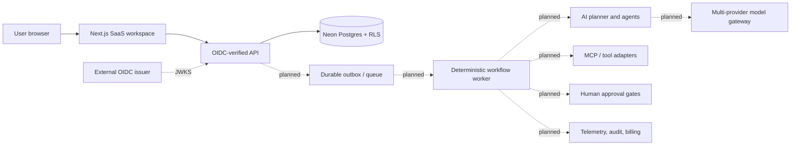

# Nexx Orbit hybrid control plane

## Roles
- Platform operators: separate control-plane identity and audited tenant support (not implemented).
- Tenant owner/admin: administration; builder: author workflows; operator: start runs; viewer: read only.
- **Tenant membership is resolved from the database on every request.** A tenant dropdown never grants access.
- Every request uses a transaction with `app.subject` and optional `app.tenant_id` scoped via `set_config(..., true)`. FORCE RLS policies scope returned rows and allowed writes.

## Lifecycle
1. Register user in trusted OIDC provider (future sign-in).
2. Controlled provisioning creates organization and active membership (future control plane).
3. Member creates draft workflow `graph` using protected API (implemented).
4. Authorized publish creates immutable workflow revision (future).
5. Operator creates queued run for published workflow (implemented, **no executor**).
6. Deterministic worker consumes version-pinned execution with transactionally persisted state (future).
7. Planner selects bounded agents and tools, subject to budgets and human approvals (future).
8. Every step records trace, output refs, retry decisions and cost, with terminal run status (future).

## Prioritized phases
- F0 **done as source code**: Next.js shell, interactive demo preservation, OIDC verification module, tenant queries, basic RLS schema, tests, CI.
- F1 **next**: OIDC/Google login, tenant onboarding, invitations, restricted DB role setup, transactional integration tests, UI data binding.
- F2 **next**: graph validation (cycle rules), workflow publish/versioning, durable queue/outbox, worker runtime, retries, idempotency, approvals.
- F3: model/provider routing, MCP capability mediation, secret vault, tenant memory/RAG, budgets, evaluations.
- F4: billing and metering, governance, SLO dashboards, access review, security acceptance and deployment.

## Trust boundaries
The original browser demo is synthetic and has no authority. Token verification must use issuer, audience, expiry and trusted JWKS. Backend database role must not bypass RLS. Tenants and memberships are only provisioned by a separate privileged server process. All background jobs must re-establish tenant context and make tenant-policy checks, not trust queued tenant IDs.
